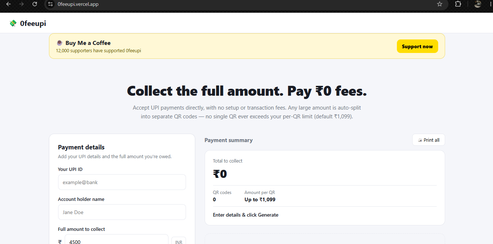
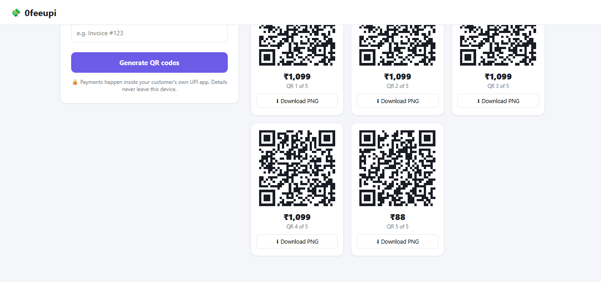
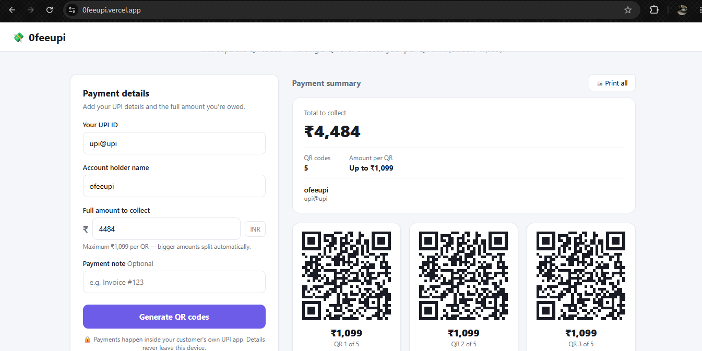

  
  <h1>🛡️ 0FeeUPI — Collect Full Amount. Pay ₹0 Fees.</h1>
  
<strong>100% Client-Side, Open-Source Automatic UPI QR Code Splitter</strong>

  

    
    
    
  

  

    
    
    
    
  

---

## 🚀 Live Interface & Working Proof

| 1. Clean Setup & Support | 2. Smart Payment Summary | 3. Auto-Split QR Grid |
| :---: | :---: | :---: |
|  |  |  |
| *Zero setup या transaction fee के साथ सीधा UPI पेमेंट लें* | *₹4,484 को ऑटोमैटिक 5 QR कोड्स में बांटा गया* | *4x ₹1,099 + 1x ₹88 QR कोड्स (PNG डाउनलोड के साथ)* |

---

## 🔒 100% Safe & Anti-Scam Proof (Ye Website Scam Kyu Nahi Hai?)

Paise aur UPI ke mamle me har user ko 100% bharosa milna chahiye. Yahan **0FeeUPI** ke safe hone ka pura technical proof hai:

1. **🔒 Details Never Leave Your Device:** Jaisa ki website ke button ke niche saaf likha hai—sari calculation aapke phone ya PC ke browser ke andar (`index.html` me) hoti hai. Hamara koi backend server ya database nahi hai.
2. **🏦 Direct Bank-to-Bank UPI Standard:** Har QR code official NPCI UPI link format (`upi://pay?pa=YOUR_UPI_ID&pn=YOUR_NAME&am=SPLIT_AMOUNT&cu=INR`) se banta hai. Jab customer GPay, PhonePe, ya Paytm se scan karta hai, toh paisa seedha aapke daale gaye **UPI ID** par hi jata hai.
3. **🔍 Open Source Code Verification:** Pura source code is repository ki `index.html` file me khula rakha hai. Koi bhi developer code padh kar ya browser me `F12 -> Network Tab` khol kar check kar sakta hai ki aapki UPI ID kahin bhi internet par send ya save nahi hoti.

---

## ⚙️ ₹1,099 Auto-Split Kaise Kaam Karta Hai?

Bade UPI payments ko chote parts me todne ke liye **0FeeUPI** har QR code ki maximum limit **₹1,099** rakhta hai:

* **Step 1:** Apni **UPI ID**, **Account Holder Name**, **Full Amount to Collect (INR)**, aur optional **Payment Note (e.g. Invoice #123)** dalein.
* **Step 2:** **`Generate QR codes`** button par click karein.
* **Step 3 (Example Breakdown):** Maan lijiye aapne **₹4,484** dala, toh website turant **5 QR Codes** bana degi:
  * **QR 1 to QR 4:** `₹1,099` each (`₹1,099 × 4 = ₹4,396`)
  * **QR 5:** `₹88` (Bacha hua balance = `₹4,484`)
* **Step 4:** Aap har QR ko **`↓ Download PNG`** button se save kar sakte hain ya **`🖨️ Print all`** button se ek sath print nikal sakte hain!

---

## 🤝 Official Community & Developer Contact

Agar aapko ye tool pasand aaya, toh website ke top par diye gaye **☕ Buy Me a Coffee (`Support now`)** button se project ko support zaroor karein! Naye open-source tools aur tech updates ke liye hamare Telegram se judein:

* 📢 **Join Official Telegram Channel:** [@developerlap](https://t.me/developerlap)
* 👨‍💻 **Telegram Channel Owner:** [@devloperg](https://t.me/devloperg)
* 🌐 **Official Web App:** [https://0feeupi.vercel.app/](https://0feeupi.vercel.app/)

---

  Built with ❤️ by <b>Developerlap (@devloperg)</b> | 100% Free & Open-Source Forever

